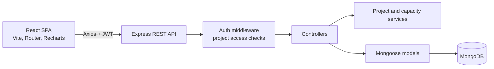

# System architecture

## Request path

1. The user signs in through `/api/auth`; bcrypt validates the password and JWT identifies the user.
2. Axios includes the bearer token on protected calls.
3. Express routes validate ObjectIds and apply authentication middleware.
4. Controllers validate required data and references; services check project access and workload capacity.
5. Mongoose persists a model update. Central error middleware maps validation, casting, duplicate-key, and unexpected errors to JSON responses.
6. The frontend reloads records and derives page state from API results.

## Source layout

- `frontend/src/components`: reusable dashboard components.
- `frontend/src/pages`: route pages (overview, backlog, planning, board, analytics, readiness, team, projects, settings).
- `frontend/src/context`: authenticated user and selected project/sprint state.
- `frontend/src/services/api.js`: Axios client and API adapters.
- `backend/src/config`: runtime environment and MongoDB connection.
- `backend/src/routes`: REST route composition.
- `backend/src/controllers`: HTTP validation and response handling.
- `backend/src/services`: project access and capacity rules.
- `backend/src/models`: MongoDB document schemas.
- `backend/src/middleware`: authentication, ObjectId validation, centralized errors.

## Derived metrics

Sprint metrics and readiness are calculated from MongoDB records when requested; no cached score is maintained. Task moves append a history entry with `previousStatus`, `status`, `changedBy` and `changedAt`. See [health and readiness rules](../backend/docs/SPRINT_HEALTH_AND_MVP_READINESS.md).
